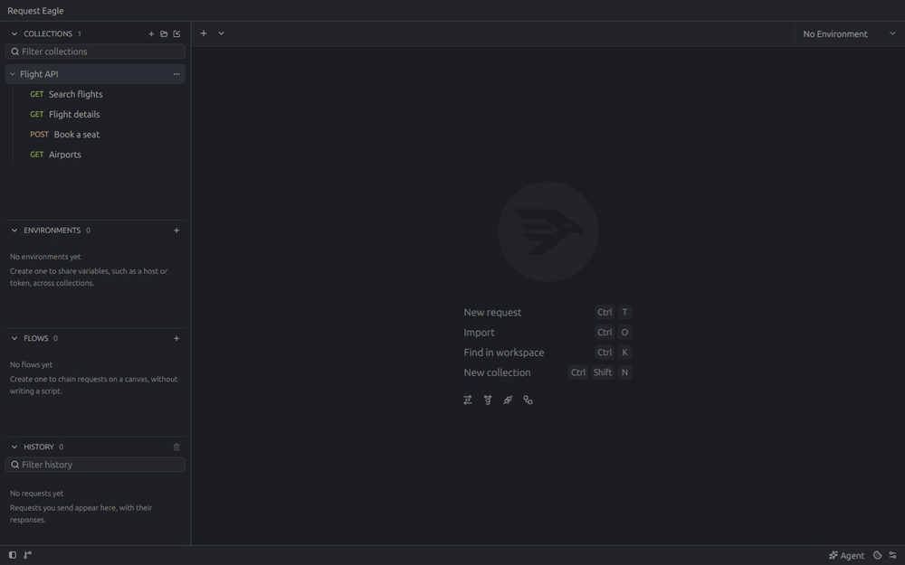

<p align="center">
  
</p>

<h1 align="center">Request Eagle</h1>

<p align="center">A native, open-source API client for macOS, Windows and Linux: a Postman alternative written in Rust that keeps requests as Git-friendly TOML files on your disk, with scripts, Vim mode, an agent panel for Claude Code, Codex or OpenCode, and a CLI for agents.</p>

<p align="center">
  <a href="https://requesteagle.tokarev.work/downloads/">Download</a>
  ·
  <a href="https://requesteagle.tokarev.work">Website</a>
  ·
  <a href="https://github.com/gregor-tokarev/request-eagle/issues">Feedback &amp; ideas</a>
</p>

<p align="center">
  
</p>

## Features

- A real desktop app with no web view, built in Rust on GPUI. It answers the first keystroke 0.36 s after launch; Postman takes 12 times as long.
- Requests are TOML files on your disk. Keep a collection in an `api` folder inside your project and review it with your code.
- HTTP, gRPC and WebSocket.
- Pre-request and post-response JavaScript with the `pm` API, and a Collection Runner that replays a collection for every row of a CSV or JSON file.
- Flows chain saved requests on a canvas, with branches and loops.
- Commit, pull and push collections without leaving the app.
- Imports Postman collections and environments, OpenAPI documents and cURL commands.
- Vim mode, eleven theme families and interface sizes from 12 to 24 px.
- An agent panel for Claude Code, Codex and OpenCode, and a CLI that lets agents run saved requests without the app.

## Compared with Postman, Bruno and Yaak

| | Request Eagle | Postman | Bruno | Yaak |
| --- | --- | --- | --- | --- |
| Runs on | Native GPUI, no web view | Electron | Electron | Tauri web view |
| Open source | MIT or Apache 2.0 | No | MIT | MIT |
| Requests stored as | TOML files | Cloud workspace, or files since Postman 12 | `.bru` files | YAML files |
| Account | None | Needed for most features | None | None |
| Price | Free | Free for one user; teams from $19 per user per month | Free; Pro from $6 per user per month | Free for personal use; $79 per year for work |

Prices checked in October 2026.

## Guides

- [Request scripts](docs/scripting.md)
- [Collection Runner](docs/collection-runner.md)
- [Flows](docs/flows.md)
- [Git](docs/git.md)
- [Agent panel](docs/agent.md)
- [CLI for agents](docs/cli.md)

## Install

Get the macOS disk image, the Windows installer or a Linux package from the
[downloads page](https://requesteagle.tokarev.work/downloads/). Linux has an
AppImage for any distribution, a Debian package, an RPM package, and
`request-eagle-bin` in the AUR for Arch Linux. Every build checks for new
versions, and the macOS app installs them in place; the AUR package is
updated through pacman.

## Build from source

Install Rust, plus the Xcode command-line tools on macOS. On Linux, install a
C/C++ toolchain, CMake, `make`, `pkg-config`, and the development libraries for
Fontconfig, FreeType, X11, Wayland, and xkbcommon.

```sh
git clone https://github.com/gregor-tokarev/request-eagle.git
cd request-eagle
make run
```

## License

Request Eagle is available under the [MIT](LICENSE-MIT) or [Apache 2.0](LICENSE-APACHE) license, at your option.
